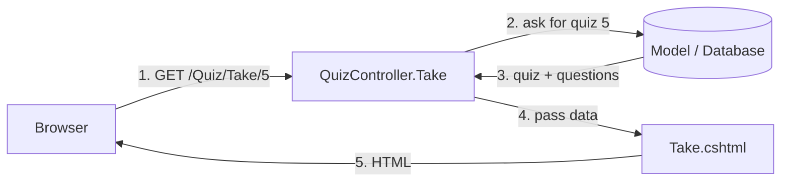
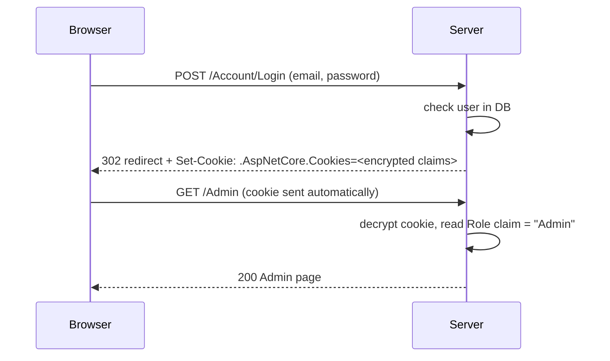
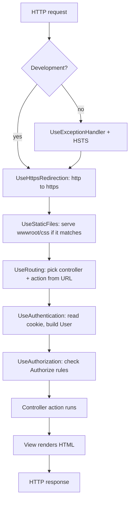
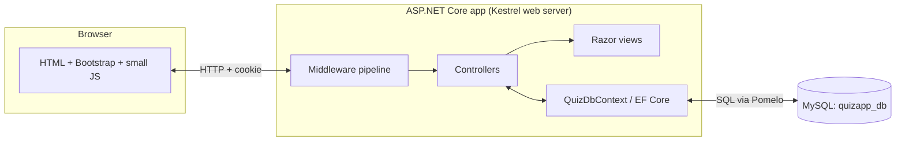
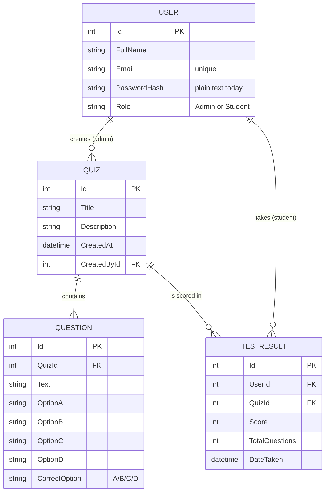
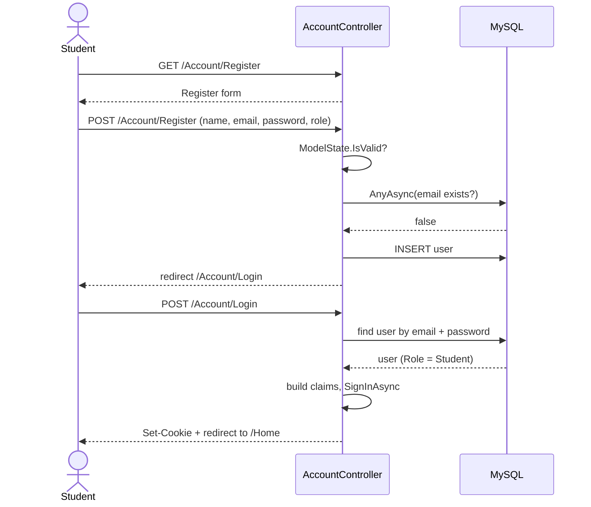
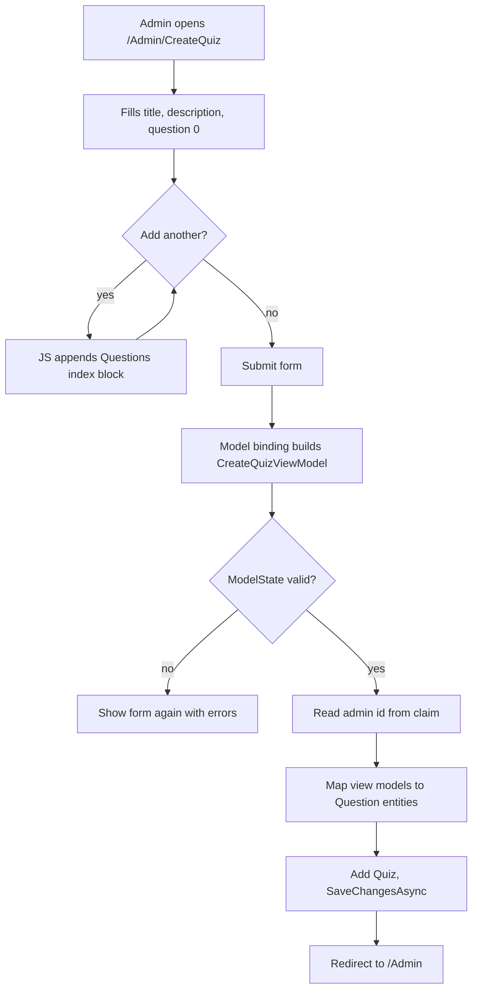
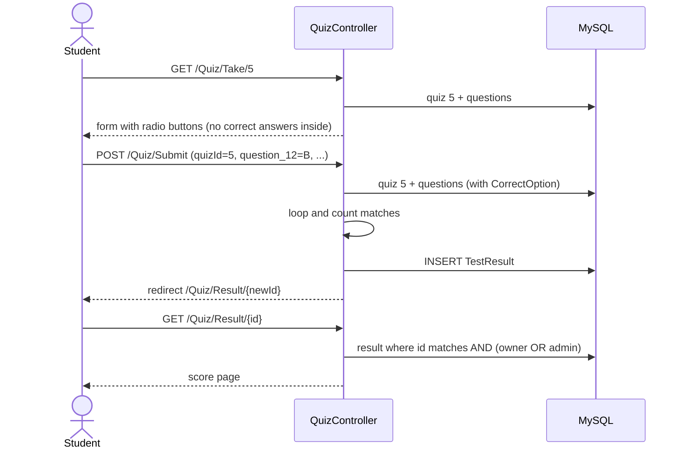

# QuizApp: the complete guide

This guide is written for someone who knows **HTML, CSS, JavaScript and Python** and nothing else.
After reading it you should be able to explain every file in this repo, answer interview questions
about it, make changes when someone asks, and build a similar app from an empty folder.

Read it in order the first time. Later, use it as a reference.

---

## Table of contents

1. [The project in one minute](#1-the-project-in-one-minute)
2. [The tech stack, explained from zero](#2-the-tech-stack-explained-from-zero)
3. [The big picture: how a request flows](#3-the-big-picture-how-a-request-flows)
4. [The database design](#4-the-database-design)
5. [File-by-file tour](#5-file-by-file-tour)
6. [The main user flows, step by step](#6-the-main-user-flows-step-by-step)
7. [Decisions and why they were made](#7-decisions-and-why-they-were-made)
8. [Honest weaknesses and how to fix them](#8-honest-weaknesses-and-how-to-fix-them)
9. [Build it yourself from scratch](#9-build-it-yourself-from-scratch)
10. [Change requests you might get (with answers)](#10-change-requests-you-might-get-with-answers)
11. [Interview and recruiter questions](#11-interview-and-recruiter-questions)
12. [Glossary](#12-glossary)
13. [Self-check exercises](#13-self-check-exercises)

---

## 1. The project in one minute

**What it does:** A website where a teacher (Admin) creates multiple-choice quizzes and students take
them. The score is calculated on the server and saved, so both the student and the admin can see it later.

**Who uses it:**

| Role | Can do |
|------|--------|
| Student | Register, log in, see all quizzes, take a quiz, see their own scores |
| Admin | Everything above except the student dashboard, plus create quizzes and see everyone's results |

**Elevator pitch for an interview (memorise the idea, not the words):**

> "QuizApp is a full-stack ASP.NET Core MVC app. It uses Entity Framework Core to talk to MySQL,
> cookie authentication with two roles, and Razor views styled with Bootstrap. I built it to learn
> the MVC pattern end to end: routing, controllers, models, views, an ORM, and role-based security."

---

## 2. The tech stack, explained from zero

You know Python and JavaScript. Every tool below is compared to something you already know.

### 2.1 C# (the language)

C# ("C sharp") is a language made by Microsoft. It looks like Java or JavaScript with types.

| Python | JavaScript | C# |
|--------|-----------|----|
| `name = "Pank"` | `let name = "Pank"` | `string name = "Pank";` or `var name = "Pank";` |
| `def add(a, b): return a + b` | `function add(a,b){return a+b}` | `int Add(int a, int b) => a + b;` |
| `class User:` | `class User {}` | `public class User { }` |
| list `[]` | array `[]` | `List<T>` |
| `None` | `null` | `null` |

Key ideas you will see in this repo:

- **Types are required.** `int Score` can only hold whole numbers. The compiler catches mistakes before you run.
- **Properties:** `public string Title { get; set; }` is a field with a getter and setter. Think of it as `self.title` in Python.
- **`?` after a type** (`User?`) means "this can be null".
- **`async` / `await`** work like JavaScript's. `await _context.SaveChangesAsync()` waits for the database without freezing the server.
- **Attributes** in square brackets, like `[Required]` or `[HttpPost]`, are labels that frameworks read. They are like Python decorators (`@app.route`).
- **Lambdas:** `q => q.Questions` is the same as JavaScript's `q => q.questions`.
- **LINQ** (`.Where(...)`, `.OrderByDescending(...)`, `.Select(...)`) is like JavaScript's `.filter()`, `.sort()`, `.map()`.

### 2.2 .NET 8

.NET is the platform that runs C# code, like the Python interpreter runs `.py` files. `.NET 8` is the version.
The `dotnet` command is your tool for everything: `dotnet new`, `dotnet run`, `dotnet build`, `dotnet add package`.

`QuizApp.MVC.csproj` is the project file. It is like `requirements.txt` plus project settings in one XML file.

### 2.3 ASP.NET Core

ASP.NET Core is the web framework for .NET. If you have seen **Flask or Django** in Python, it is the same idea:
it receives HTTP requests, runs your code and returns HTML.

| Flask | ASP.NET Core |
|-------|--------------|
| `app = Flask(__name__)` | `var builder = WebApplication.CreateBuilder(args);` |
| `@app.route("/login")` | a method `Login()` inside `AccountController` (found by convention) |
| `render_template("login.html")` | `return View();` |
| `redirect(url_for("home"))` | `return RedirectToAction("Index", "Home");` |
| Jinja templates | Razor views (`.cshtml`) |
| `app.run()` | `app.Run();` |

### 2.4 MVC (Model, View, Controller)

MVC is a way to split code into three jobs:

- **Model:** the data and its rules. Here: `User`, `Quiz`, `Question`, `TestResult`.
- **View:** the HTML the user sees. Here: the `.cshtml` files.
- **Controller:** the traffic police. It receives the request, asks the model for data, picks a view.



Why split it? Each part can change alone. A designer edits views without touching database code.

### 2.5 Routing by convention

`Program.cs` has this line:

```csharp
pattern: "{controller=Home}/{action=Index}/{id?}"
```

It means the URL decides which code runs:

| URL | Controller class | Method | `id` |
|-----|------------------|--------|------|
| `/` | `HomeController` | `Index()` | none |
| `/Account/Login` | `AccountController` | `Login()` | none |
| `/Quiz/Take/7` | `QuizController` | `Take(7)` | 7 |
| `/Admin/Results` | `AdminController` | `Results()` | none |

The word "Controller" is dropped from the class name in the URL. `{id?}` means id is optional.

### 2.6 Razor views (`.cshtml`)

Razor is HTML with C# mixed in, using `@`. Like Jinja's `{{ }}` and ``.

```cshtml
@model List<Quiz>             @* this view receives a list of quizzes *@
@foreach (var quiz in Model)  @* a C# loop inside HTML *@
{
    <h3>@quiz.Title</h3>      @* print a value, auto-escaped (safe from XSS) *@
}
```

**Tag helpers** are HTML attributes that start with `asp-`. They generate correct links and form names:

- `<a asp-controller="Admin" asp-action="Index">` becomes `<a href="/Admin">`.
- `<input asp-for="Title">` becomes `<input name="Title" id="Title" ...>` with validation attributes.

`_Layout.cshtml` is the master page (navbar, footer, Bootstrap). Every view is placed inside it at `@RenderBody()`.
`_ViewStart.cshtml` tells every view to use that layout. `_ViewImports.cshtml` adds `using` lines and enables tag helpers everywhere.

### 2.7 Entity Framework Core (EF Core), an ORM

An **ORM** (Object Relational Mapper) lets you use classes instead of writing SQL. Python has SQLAlchemy and Django ORM; this is the .NET one.

| You write (C#) | EF Core sends to MySQL (roughly) |
|----------------|-----------------------------------|
| `_context.Quizzes.ToListAsync()` | `SELECT * FROM Quizzes` |
| `.Where(r => r.UserId == 3)` | `WHERE UserId = 3` |
| `.Include(q => q.Questions)` | a `JOIN` to load the related questions |
| `_context.Users.Add(user); SaveChangesAsync()` | `INSERT INTO Users ...` |

`QuizDbContext` is the class that represents the whole database. Each `DbSet<T>` is one table.

### 2.8 Pomelo + MySQL

**MySQL** is the database server that stores the data on disk. **Pomelo.EntityFrameworkCore.MySql** is the
"driver" that teaches EF Core how to speak MySQL. (EF Core supports SQL Server by default; for MySQL you need Pomelo.)

### 2.9 Cookie authentication and claims

When you log in, the server creates a **cookie**: a small encrypted text the browser stores and sends with every request.
Inside the cookie are **claims**: facts about you, like your id, name, email and role.



`[Authorize]` on a controller means "you must be logged in". `[Authorize(Roles = "Admin")]` means "you must be logged in AND have the Admin role".
If not logged in, you are sent to `LoginPath`. If logged in with the wrong role, you go to `AccessDeniedPath`.

### 2.10 Dependency injection (DI)

Look at this constructor:

```csharp
public AccountController(QuizDbContext context) { _context = context; }
```

You never write `new AccountController(...)`. The framework builds it for you and passes a `QuizDbContext`,
because `Program.cs` registered it with `AddDbContext`. This is **dependency injection**: classes ask for what
they need, and a central container provides it. Benefit: easy to swap (for example, a fake DB in tests).

### 2.11 Bootstrap 5

A CSS library loaded from a CDN in `_Layout.cshtml`. Classes like `btn btn-primary`, `card`, `container`, `row`, `col-md-6`
give you ready-made styling and a responsive grid. You already know CSS; Bootstrap is pre-written CSS with class names.

### 2.12 Model binding and validation

When a form is posted, ASP.NET Core reads the form fields and fills a C# object automatically. This is **model binding**.

```html
<input name="Email"> <input name="Password">
```

becomes a `LoginViewModel` with `Email` and `Password` set. Names must match property names.

For lists, the names use indexes: `Questions[0].Text`, `Questions[1].Text`. That is how the Create Quiz form sends many questions at once.

Attributes like `[Required]` and `[EmailAddress]` define rules. `ModelState.IsValid` is `true` only if all rules pass.

---

## 3. The big picture: how a request flows

Every request passes through a **middleware pipeline**, set up in `Program.cs`. Middleware are steps, in order, like airport security checks.



**Why order matters:** authentication must run before authorization. You cannot check a role before you know who the user is.
Static files come early so CSS requests skip the rest.

### Architecture



There is no separate frontend app and no JSON API. The server builds full HTML pages. This style is called
**server-side rendering (SSR)** or a "multi-page app".

---

## 4. The database design



How EF Core knows this:

- A property called `Id` becomes the **primary key** (auto-increment).
- `QuizId` plus a `Quiz?` property becomes a **foreign key**. This is "convention over configuration".
- `List<Question> Questions` on `Quiz` is a **navigation property**: one quiz has many questions.
- `OnModelCreating` adds one extra rule by hand: a unique index on `Email`.

**Design choice: four option columns (OptionA..D).** Simple and fast to build, but you cannot have 3 or 5 options.
A more flexible design is a separate `Option` table (`Id, QuestionId, Text, IsCorrect`). Be ready to say this in interviews.

**Why save `TotalQuestions` in `TestResult`?** If an admin later adds questions to a quiz, old results still show the
correct "7 out of 10" instead of changing to "7 out of 12". This is called **snapshotting**.

---

## 5. File-by-file tour

### Root

| File | What it is |
|------|------------|
| `README.md` | Public description, setup steps, roadmap |
| `LICENSE` | MIT licence: anyone can reuse the code with credit |
| `.gitignore` | Tells Git to ignore `bin/`, `obj/` (build output) and IDE files |
| `AGENTS.md` | Rules for AI coding tools |
| `GUIDE.md` | This file |

### `QuizApp/Program.cs` (startup)

Runs once when the app starts. Six steps, each commented in the file:

1. `AddControllersWithViews()`: turn on MVC.
2. `AddDbContext<QuizDbContext>(UseMySql(...))`: register the database, read the connection string from `appsettings.json`.
   `ServerVersion.AutoDetect` connects once to ask MySQL its version (so the app needs MySQL running to start).
3. `AddAuthentication().AddCookie(...)`: cookie login, with the paths for login, logout and access denied.
4. The middleware pipeline (section 3).
5. `MapControllerRoute`: the URL pattern.
6. `EnsureCreated()`: if the database or tables do not exist, create them from the model classes.

### `QuizApp/QuizApp.MVC.csproj`

Target `net8.0`, nullable warnings on, implicit `using`s on, and three NuGet packages (NuGet is .NET's pip):
EF Core, EF Core Design (tools for migrations), Pomelo MySQL.

### `QuizApp/appsettings.json` and `appsettings.Development.json`

Configuration as JSON, like a `.env` file. `ConnectionStrings:DefaultConnection` tells EF Core where MySQL is.
The Development file overrides values when `ASPNETCORE_ENVIRONMENT=Development`.
**Never commit a real password.** Use `dotnet user-secrets` locally (see section 10).

### `QuizApp/Models/Models.cs`

All classes in one file:

- **Entities** (become tables): `User`, `Quiz`, `Question`, `TestResult`.
- **View models** (shape of forms, never stored directly): `LoginViewModel`, `RegisterViewModel`,
  `CreateQuizViewModel`, `QuestionViewModel`.

Why separate view models? The Register form has `Password`, but the table has `PasswordHash`. The form should never be able
to set `Id` or other fields it should not touch. This protects against **over-posting** (a user adding extra form fields).

### `QuizApp/Data/QuizDbContext.cs`

Four `DbSet`s (tables) and `OnModelCreating` with the unique email index.

### `QuizApp/Controllers/AccountController.cs`

| Action | HTTP | Does |
|--------|------|------|
| `Login()` | GET | Show the form |
| `Login(model)` | POST | Find a user with that email and password, build claims, `SignInAsync` (creates cookie), redirect by role |
| `Register()` | GET | Show the form |
| `Register(model)` | POST | Reject duplicate email, save new user, redirect to Login |
| `Logout()` | POST | `SignOutAsync` (deletes cookie), redirect to Login |

Note `Role = model.Role == "Admin" ? "Admin" : "Student"`. This **whitelists** the role: if someone posts
`Role=SuperUser`, they still become a Student.

### `QuizApp/Controllers/AdminController.cs`

Marked `[Authorize(Roles = "Admin")]` at class level, so every action is admin-only.

- `Index`: all quizzes with questions and creator (`Include` = JOIN), newest first.
- `CreateQuiz` GET: empty form. POST: read the admin id from the cookie claim, map each `QuestionViewModel` to a `Question` with `.Select(...)`, save quiz and questions in one `SaveChangesAsync` (EF inserts the quiz first, then the questions with the new quiz id).
- `Results`: every `TestResult` with user and quiz, newest first.

### `QuizApp/Controllers/HomeController.cs`

`[Authorize]` (any logged-in user). `Index` redirects admins to `/Admin`. For students it loads all quizzes plus this
student's results and passes the results in `ViewBag.Results` (a dynamic bag for extra data). The view matches results
to quiz cards to show a score and progress bar.

`Error` has `[AllowAnonymous]` so the error page works even when logged out.

### `QuizApp/Controllers/QuizController.cs`

- `Take(id)`: load quiz with questions, or `404 Not Found`.
- `Submit(quizId, form)`: this is the scoring logic.

```csharp
int score = 0;
foreach (var question in quiz.Questions)
{
    var answer = form[$"question_{question.Id}"].ToString();
    if (answer == question.CorrectOption) score++;
}
```

The radio buttons in `Take.cshtml` are named `question_12`, `question_13`... with values A/B/C/D.
**Important security point:** the correct answers are never sent to the browser. The score is calculated on the server,
so a student cannot cheat by reading the page source.

- `Result(id)`: show one result. The query includes `r.UserId == userId || User.IsInRole("Admin")`, so a student
  cannot open another student's result by changing the number in the URL. This prevents an **IDOR** bug (Insecure Direct Object Reference).

### Views

| View | Shows |
|------|-------|
| `Shared/_Layout.cshtml` | Navbar (links change by role), Bootstrap CSS/JS, `@RenderBody()` |
| `Shared/Error.cshtml` | Friendly error page |
| `_ViewStart.cshtml` | `Layout = "_Layout"` for all views |
| `_ViewImports.cshtml` | Shared `@using` and `@addTagHelper` |
| `Account/Login`, `Account/Register` | Forms with `asp-for` and validation messages |
| `Home/Index` | Student dashboard: quiz cards, score badge, progress bar |
| `Admin/Index` | Admin quiz cards with question count and creator |
| `Admin/CreateQuiz` | The quiz builder. Has a `<script>` that adds more question blocks (see below) |
| `Admin/Results` | Table of all attempts |
| `Quiz/Take` | One radio group per question, hidden `quizId` field |
| `Quiz/Result` | Score, percentage, message |

**The JavaScript in CreateQuiz.cshtml:** it keeps a counter `index`. When you click "Add question", it builds a new HTML
block with a template string where every input is named `Questions[${index}].Text` and so on, appends it to the form and
increments `index`. On submit, model binding turns all of them into `List<QuestionViewModel>`. This is plain JavaScript you already know.

### `wwwroot/css/site.css`

Custom CSS on top of Bootstrap. `wwwroot` is the public folder: files here are served directly, like Flask's `static/`.

---

## 6. The main user flows, step by step

### 6.1 Register then log in



### 6.2 Admin creates a quiz



### 6.3 Student takes a quiz



The pattern "POST, then redirect, then GET" is called **Post/Redirect/Get (PRG)**. It stops the browser from re-submitting
the quiz if the user presses refresh.

---

## 7. Decisions and why they were made

| Decision | Why | Trade-off |
|----------|-----|-----------|
| ASP.NET Core MVC (not React + API) | One project, one language, server builds HTML. Good for learning MVC | Less interactive UI; full page reloads |
| EF Core ORM | No hand-written SQL, type-safe queries, relations handled | Less control over exact SQL; must learn `Include` |
| MySQL with Pomelo | Free, popular, common in college labs | Needs a running server; SQLite would be simpler for demos |
| Cookie auth (custom) | Small and easy to understand | ASP.NET Identity gives hashing, lockout, reset for free |
| `EnsureCreated()` | Zero setup for a demo | Cannot evolve the schema; migrations are the real way |
| Four option columns | Fast to build, easy form | Fixed to exactly 4 options |
| View models separate from entities | Safety (no over-posting), form shape can differ from table | More classes to write |
| Server-side scoring | Answers never reach the browser, no cheating | Needs a round trip |
| `ViewBag.Results` | Quick way to pass a second list to the view | Not type-safe; a proper `DashboardViewModel` is cleaner |
| Bootstrap from CDN | No build step | Needs internet; version pinned in layout |

---

## 8. Honest weaknesses and how to fix them

Knowing your project's weak points is a strength in interviews. Say them before the interviewer does.

1. **Plain-text passwords.** `PasswordHash` stores the raw password.
   *Fix:* add the `BCrypt.Net-Next` package. On register: `BCrypt.Net.BCrypt.HashPassword(model.Password)`.
   On login: find the user by email only, then `BCrypt.Net.BCrypt.Verify(model.Password, user.PasswordHash)`.
2. **Anyone can register as Admin.** *Fix:* remove the role choice from the public form; seed the first admin, or let admins promote users.
3. **No anti-forgery check on POST.** The form tag helper already adds a hidden token, but nothing validates it.
   *Fix:* add `[ValidateAntiForgeryToken]` to POST actions, or globally: `AddControllersWithViews(o => o.Filters.Add(new AutoValidateAntiforgeryTokenAttribute()))`.
4. **`EnsureCreated` instead of migrations.** *Fix:* `dotnet tool install --global dotnet-ef`, `dotnet ef migrations add Initial`, replace `EnsureCreated()` with `db.Database.Migrate()`.
5. **Quizzes cannot be edited or deleted.** *Fix:* add `Edit` and `Delete` actions in `AdminController` (section 10).
6. **No tests.** *Fix:* create an xUnit project and test the scoring logic by moving it into a small service class.
7. **Empty quiz possible?** The form starts with one question and inputs are `required` in HTML, but the server does not check
   `model.Questions.Count > 0`. *Fix:* add that check and a `ModelState.AddModelError`.
8. **A student can retake a quiz unlimited times.** That might be intended. If not, check for an existing result before saving.

---

## 9. Build it yourself from scratch

Do this once without copying. It is the best way to really own the project.

### Step 0: install

- .NET 8 SDK: https://dotnet.microsoft.com/download (check with `dotnet --version`)
- MySQL 8 (or use Docker: `docker run -d -p 3306:3306 -e MYSQL_ROOT_PASSWORD=pass mysql:8`)
- VS Code with the "C# Dev Kit" extension (free)

### Step 1: create the project

```bash
dotnet new mvc -n QuizApp.MVC -o QuizApp
cd QuizApp
dotnet run        # open the URL it prints; you see the default template
```

The template gives you `Program.cs`, `Controllers/HomeController.cs`, `Views/`, `wwwroot/`. Look around.

### Step 2: add packages

```bash
dotnet add package Microsoft.EntityFrameworkCore --version 8.0.8
dotnet add package Microsoft.EntityFrameworkCore.Design --version 8.0.8
dotnet add package Pomelo.EntityFrameworkCore.MySql --version 8.0.2
```

### Step 3: models

Create `Models/Models.cs` with `User`, `Quiz`, `Question`, `TestResult`. Start with just `User` and `Quiz`, run, then add the rest.

### Step 4: DbContext and connection

Create `Data/QuizDbContext.cs` with the four `DbSet`s. Put the connection string in `appsettings.json`.
In `Program.cs` add `AddDbContext` and, after `Build()`, the `EnsureCreated()` block. Run. Open MySQL and check the tables exist:
`SHOW TABLES FROM quizapp_db;`

### Step 5: authentication

Add `AddAuthentication(...).AddCookie(...)`, then `UseAuthentication()` before `UseAuthorization()`.
Write `AccountController` with Register first (save a user), then Login (claims + `SignInAsync`), then Logout.
Write the two views. Test: register, log in, check the browser's dev tools > Application > Cookies.

### Step 6: admin area

Add `AdminController` with `[Authorize(Roles = "Admin")]`. Build `CreateQuiz` with a single question first.
Then add the JavaScript to add more question blocks. Then `Index` and `Results`.

### Step 7: student flow

`HomeController.Index` (list quizzes), `QuizController.Take`, `Submit`, `Result`.

### Step 8: polish

Layout navbar that changes by role (`@if (User.IsInRole("Admin"))`), Bootstrap cards, progress bars.

### Step 9: commit as you go

```bash
git init
git add . && git commit -m "Create MVC project"
# one commit per step above
```

**Time estimate for a first rebuild:** 2 to 4 weekends at 2 to 3 hours each.

---

## 10. Change requests you might get (with answers)

Practise each one by hand. These are exactly the kind of "can you change X" tasks interviewers give.

### 10.1 "Add a timer to the quiz."

Add `public int TimeLimitMinutes { get; set; }` to `Quiz` and to `CreateQuizViewModel`, add an input in `CreateQuiz.cshtml`,
map it in the controller. In `Take.cshtml`, add JavaScript:

```html
<div id="timer"></div>
<script>
  let left = @Model.TimeLimitMinutes * 60;
  const t = setInterval(() => {
    left--;
    document.getElementById('timer').textContent =
      Math.floor(left / 60) + ':' + String(left % 60).padStart(2, '0');
    if (left <= 0) { clearInterval(t); document.querySelector('form').submit(); }
  }, 1000);
</script>
```

Because the schema changed and the app uses `EnsureCreated`, drop the database (`DROP DATABASE quizapp_db;`) and restart. Mention that migrations would avoid this.
For a cheat-proof timer, also store the start time on the server and reject late submissions.

### 10.2 "Let the admin delete a quiz."

In `AdminController`:

```csharp
[HttpPost]
public async Task<IActionResult> Delete(int id)
{
    var quiz = await _context.Quizzes.FindAsync(id);
    if (quiz == null) return NotFound();
    _context.Quizzes.Remove(quiz);
    await _context.SaveChangesAsync();
    return RedirectToAction("Index");
}
```

In `Admin/Index.cshtml`, add a small form per card: `<form asp-action="Delete" asp-route-id="@quiz.Id" method="post"><button class="btn btn-danger btn-sm">Delete</button></form>`.
Questions and results are deleted too because EF Core's default for required foreign keys is **cascade delete**.
Use POST (not a GET link) because GET requests must never change data.

### 10.3 "Hash the passwords."

See section 8, item 1. Existing plain-text users will no longer be able to log in, so reset the dev database.

### 10.4 "Show the correct answers on the result page."

In `QuizController.Submit`, you would need to store each answer. Add an `Answer` entity (`TestResultId, QuestionId, Chosen`),
save one per question, then in `Result` load them with `Include` and show green/red per question.

### 10.5 "Use SQLite so it runs without MySQL."

`dotnet add package Microsoft.EntityFrameworkCore.Sqlite`, then in `Program.cs` replace `UseMySql(...)` with
`options.UseSqlite("Data Source=quiz.db")`. Nothing else changes. This shows the value of an ORM.

### 10.6 "Add a leaderboard."

New action in `HomeController`:

```csharp
var top = await _context.TestResults
    .Where(r => r.QuizId == id)
    .Include(r => r.User)
    .OrderByDescending(r => r.Score)
    .Take(10)
    .ToListAsync();
```

### 10.7 "Change the colours / design."

Edit `wwwroot/css/site.css` and the Bootstrap classes in the views. For a theme, override Bootstrap CSS variables:
`:root { --bs-primary: #6f42c1; }`.

### 10.8 "Store the connection string safely."

```bash
dotnet user-secrets init
dotnet user-secrets set "ConnectionStrings:DefaultConnection" "Server=...;Password=real;"
```

User secrets are stored outside the repo and override `appsettings.json` in Development.

---

## 11. Interview and recruiter questions

**Q: Walk me through what happens when a student submits a quiz.**
The form posts `quizId` and one `question_{id}` field per question to `/Quiz/Submit`. The action loads the quiz with
its questions using EF Core, compares each posted letter with `CorrectOption`, counts matches, saves a `TestResult`
with score and total, then redirects to the result page (Post/Redirect/Get).

**Q: Why MVC?**
Separation of concerns. Controllers handle requests, models hold data rules, views render HTML. Each can change independently, and the folder structure tells you where everything lives.

**Q: How does authentication work?**
Cookie authentication. On login I build claims (id, name, email, role), create a `ClaimsPrincipal` and call `SignInAsync`,
which writes an encrypted cookie. `UseAuthentication` reads it on each request. `[Authorize(Roles="Admin")]` checks the role claim.

**Q: What is the difference between authentication and authorization?**
Authentication answers "who are you?" (login). Authorization answers "what are you allowed to do?" (roles).

**Q: What is an ORM? Why EF Core?**
It maps classes to tables so I write C# instead of SQL. It gives type safety, handles relationships, and makes switching
databases easy (I can swap MySQL for SQLite by changing one line).

**Q: What does `Include` do? What is the N+1 problem?**
`Include` loads related data in the same query (a JOIN). Without it, looping over 20 quizzes and reading `quiz.Questions`
could fire 20 extra queries: that is N+1. Here, related data is not lazy-loaded at all, so without `Include` the list would just be empty.

**Q: What is dependency injection?**
Classes declare what they need in the constructor; the framework provides it. `QuizDbContext` is registered once in `Program.cs`
and injected into every controller. It makes code testable and loosely coupled. DbContext is registered as **scoped**: one instance per HTTP request.

**Q: How do you stop a student from seeing another student's result?**
The `Result` query filters by `UserId == currentUserId` unless the user is an Admin, so changing the id in the URL returns 404.

**Q: Can a student cheat by reading the HTML?**
No. The correct option is never rendered in `Take.cshtml`. Scoring happens on the server.

**Q: What are the security problems?**
Be honest: plain-text passwords, open admin registration, and missing anti-forgery validation. Then explain the fix for each (section 8).
This answer impresses more than pretending the project is perfect.

**Q: What is model binding?**
ASP.NET Core maps form fields to C# objects by name. `Questions[0].Text` binds to the first item of the `Questions` list.

**Q: `async`/`await`, why?**
Database calls are I/O. `await` frees the server thread while waiting, so it can serve other requests. Same idea as JavaScript promises.

**Q: How would you scale this?**
Move to migrations, add indexes on foreign keys (EF adds them), hash passwords, add caching for the quiz list, host on Azure App Service or a Linux VM behind Nginx, and use a managed MySQL.

**Q: How did you use AI, and how do you know the code is right?**
See the "Talking about AI-assisted work" note at the end.

---

## 12. Glossary

| Word | Simple meaning |
|------|----------------|
| Action | A public method in a controller that answers a URL |
| Attribute | `[Something]` label on a class or method, read by the framework |
| Claim | One fact about the logged-in user stored in the cookie |
| Controller | Class that handles requests for one area |
| DbContext | Class that represents the database session |
| DbSet | One table |
| DI | Dependency injection: the framework hands you the objects you need |
| Entity | Class that maps to a table |
| Foreign key | Column that points to a row in another table |
| Kestrel | The web server built into ASP.NET Core |
| LINQ | C# query methods like `Where`, `Select` |
| Middleware | A step in the request pipeline |
| Migration | A versioned script that changes the database schema |
| Model binding | Turning form fields into C# objects |
| NuGet | .NET package manager (like pip/npm) |
| ORM | Library that maps objects to tables |
| PRG | Post/Redirect/Get pattern |
| Razor | HTML + C# template syntax |
| Tag helper | `asp-*` attribute that generates HTML |
| View model | Class shaped for one form or page, not a table |

---

## 13. Self-check exercises

Try each without looking at the code, then check.

1. Draw the four tables and their relations from memory.
2. What URL runs `AdminController.Results`? What happens if a student opens it?
3. Why is `Logout` a POST and not a link?
4. Add a "difficulty" field (Easy/Medium/Hard) to quizzes and show it on cards.
5. Add password hashing with BCrypt.
6. Replace `ViewBag.Results` with a typed `StudentDashboardViewModel`.
7. Write the SQL you think EF Core runs for `AdminController.Index`.
8. Switch to SQLite and run the app with no MySQL.

---

## Talking about AI-assisted work

A short, honest script you can adapt:

> "I used AI tools to speed up parts of the coding, the same way people use Stack Overflow or autocomplete.
> I reviewed every file, I can explain every line, and I rebuilt the core flow myself to be sure. For example,
> the scoring happens in `QuizController.Submit`..." (then explain it).

Tips:

- **Never claim you wrote every line alone.** Say "AI-assisted" and then prove understanding live.
- **Know the weaknesses** (section 8). Volunteering them shows real ownership.
- **Be ready to code live.** Practise the change requests in section 10 by hand, with no AI, until they feel easy.
- **Keep commit history honest.** Small, real commits made by you are worth more than a perfect-looking graph.
